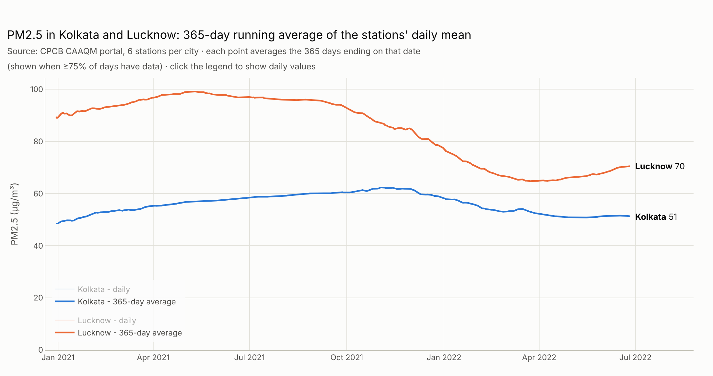

# CREA technical assignment - data engineer / data scientist

The original brief is reproduced [at the end of this page](#original-brief).

| Part | Question | Answer |
|---|---|---|
| **1a** | Share of population covered by stations within 5, 10, 50 km and beyond, for the US, UK, Turkey, Thailand, the Philippines and India | [Results](#part-1a---population-covered-by-air-quality-monitoring-stations) · code in [`part1a/`](part1a) |
| **1b** (optional) | PM2.5 from CPCB for Kolkata and Lucknow, interactive 365-day running average since 2020 | [Results](#part-1b---pm25-in-kolkata-and-lucknow-cpcb) · code in [`part1b/`](part1b) |
| **2** | Stack to collect and serve air pollution data | [Answer](#part-2---architecture) |

<!-- PART1A -->

## Part 1b - PM2.5 in Kolkata and Lucknow (CPCB)



Interactive chart (hover, zoom, range slider, daily values on click): [`part1b/results/pm25_running_average.html`](part1b/results/pm25_running_average.html)
(download and open in a browser).

- **Collection** - [`part1b/ScrapeCPCB.py`](part1b/ScrapeCPCB.py) drives the
  [CPCB CAAQM portal](https://app.cpcbccr.com/ccr/#/caaqm-dashboard-all/caaqm-landing/data) with
  Selenium: for each station of Kolkata and Lucknow it selects PM2.5, a 24-hour average and
  1 Jan 2020 onwards, then exports the table to Excel. The 12 exports (6 stations per city,
  1 Jan 2020 - 26 Jun 2022) are in [`part1b/data/`](part1b/data).
- **Processing** - [`part1b/running_average.py`](part1b/running_average.py):
  1. the daily city value is the mean of the stations that reported that day (`None` = missing,
     ignored rather than counted as 0);
  2. the running average at date *d* is the mean of the 365 days ending on *d*. It is only shown
     when the whole window lies within the data (so the first point is 30 Dec 2020) and at
     least 75% of its days have data.
- **Result** - Lucknow's annual PM2.5 fell from ~99 µg/m³ (year to May 2021) to ~65-70 µg/m³ in
  2022; Kolkata stayed around 50-60 µg/m³. Both are 10-20 times the WHO annual guideline (5 µg/m³)
  and above India's NAAQS (40 µg/m³).

Changes from the first version of this part (`PlotCPCB.ipynb`, now replaced by the script):
the running average was plotted at the *start* of each 365-day window instead of its end;
stations were matched by row position, assuming all exports had identical dates; paths were
hard-coded to a home directory. The scraper also moved the *oldest* files of `~/Downloads`
instead of the newest ones; that is fixed, but the scraper itself could not be re-run here
(the CPCB portal is not reachable from this environment).

## Part 2 - Architecture

What I would use to collect and serve air pollution data, roughly in the order data flows:

| Layer | Choice | Why |
|---|---|---|
| **Collection** | One small Python *adapter* per source (CPCB, OpenAQ, EEA, AirNow, ...) that fetches, normalises to a common schema (`station, pollutant, unit, timestamp, value, source`) and upserts. Each adapter runs as a container job on a schedule (Cloud Run Jobs + Cloud Scheduler, or Airflow/Prefect once there are dependencies between jobs). | Sources fail independently and change often; isolating them keeps one broken portal from blocking the rest. Upserts on `(station, pollutant, timestamp)` make re-runs and backfills idempotent. |
| **Scraping technique** | Call the JSON API behind a portal with `requests`/`httpx` rather than drive a browser. Selenium/Playwright is the last resort. | The CPCB dashboard is an Angular app backed by an HTTP API: calling it directly is ~100x faster and much more robust than clicking through date pickers (which is what Part 1b's Selenium scraper does). |
| **Raw storage** | Raw responses kept as-is in object storage (GCS/S3), partitioned by source/date. | Parsing bugs can be fixed and re-run without re-scraping; it is also an audit trail. |
| **Database** | PostgreSQL with **TimescaleDB** (hypertable for measurements, continuous aggregates for hourly/daily/yearly means) and **PostGIS** (station locations, admin boundaries). BigQuery as an analytical copy if datasets get very large. | One database answers both time-series ("365-day running mean in Lucknow") and spatial ("population within 10 km of a station") questions; continuous aggregates keep dashboards fast without a separate cache. |
| **Quality control** | Checks in the ingestion step: units, physical ranges, duplicates, flat-lined sensors, stale sources; flags stored with the data rather than deleting values. Freshness alerts per source. | Monitoring data is noisy (e.g. the `None` days and negative values in CPCB/OpenAQ exports); users need to know what was removed and why. |
| **API** | **FastAPI** REST API (stations, measurements, aggregates; JSON/CSV; pagination; API keys and rate limits), containerised on Cloud Run behind a CDN cache. | Typed, self-documented (OpenAPI), async, easy to test. Most queries are repeated aggregates, so HTTP caching does most of the scaling work. |
| **Frontend** | React + Plotly (or Observable Plot) + MapLibre for the public dashboard; Dash/Streamlit for internal tools; static Plotly HTML / images for reports. | Interactive charts and maps like the ones in Part 1 come out of the same API, so analysts and the public see the same numbers. |
| **Ops** | Docker, GitHub Actions CI (unit tests on adapters with recorded fixtures, linting), Terraform for infrastructure, structured logs + Sentry. | Reproducible deployments; adapters are tested against saved responses so a source changing its format shows up as a failing test, not as silently missing data. |

For a small team I would start with the managed, scale-to-zero pieces (Cloud Run, Cloud SQL Postgres + extensions, GCS) and only add a queue (Pub/Sub, Kafka) or a workflow engine when the number of sources or the update frequency calls for it.

## Repository layout

```
part1a/
  common.py          countries, distance bands, Natural Earth boundaries
  stations.py        station locations (OpenAQ archive, CREA API, CREA India table)
  coverage.py        population by distance to the nearest station
  plot.py            chart (HTML + PNG)
  data/              station lists used (stations_*.csv)
  results/           coverage tables and charts
part1b/
  ScrapeCPCB.py      Selenium scraper for the CPCB portal
  running_average.py station average + 365-day running average + chart
  data/              CPCB exports (one .xlsx per station)
  results/           daily data, running averages, chart
data/                GPWv4 population density raster (provided with the assignment)
requirements.txt
```

## Original brief

<details>
<summary>Show the assignment text</summary>

### Technical Assignment

This is a technical assignment for the data engineer / data scientist position at CREA.

#### Part 1a - Data analysis and visualisation

We at CREA have developed an online system that collects air pollution data from a dozen sources globally. In this assignment, we would like you to extract and present some insights using this dataset. Namely, we would like you to present in a single graph (subplots/facets authorised):

- the share of population covered by stations within radii of 5, 10, 50km and beyond for US, UK, Turkey, Thailand, Philippines, India. Population data available here: [data/gpw_v4_population_density_rev11_2020_15_min.tif](data/gpw_v4_population_density_rev11_2020_15_min.tif).

You can use either R or Python for data analysis, and any library or platform to create charts, except Tableau and PowerBI. Code and results can be hosted on a Markdown document, Jupyter notebook, R markdown, simple code and image files, or interactive web page.

#### Part 1b (Optional) - Data scraping and visualisation

If you have no experience with geospatial data and find yourself struggling with Part 1a, you can work on Part 1b instead. If you have finished Part 1a, you can skip directly to Part 2.

Here is a portal to access India's air quality: [CPCB](https://app.cpcbccr.com/ccr/#/caaqm-dashboard-all/caaqm-landing/data)

Collect PM2.5 daily data for all stations located in Kolkata and Lucknow using code only, and provide an **interactive** 365-day running average chart for these two cities from 2020 onward, using stations average.

#### Part 2 - Architecture

What would be your suggested and/or favourite stack to collect and serve air pollution data to users? (e.g. regular scraping, backend, data storage, frontend). Please provide justification or explanation if you have any. Keep it short!

#### Comments

We are interested in the way you solve the problems, how you structure your code and how you present results. There is no particular trap but if you have any doubt or question, feel free to contact [me](hubert@energyandcleanair.org) directly.

#### Submission

Steps:

- fork this repository;
- push your code, results and answers;
- invite [me](hubert@energyandcleanair.org) as a collaborator on your repository once you are done.

If required, you can push your results to another platform and share the link(s) with me.

</details>
